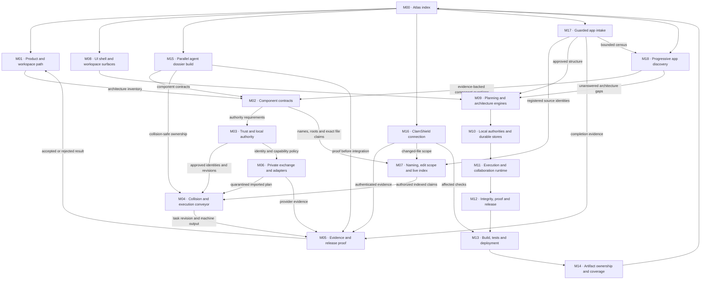

# M00 · Perfect Planner build map atlas

This is the durable entry point for studying the app. Each map is intentionally separate, top-down, and joined through stable `Mxx`, `Cxxx`, `Fxxx`, and workspace IDs. Every process node is addressed as `<map number><letter>` (`1a`, `1b`, `1c` …); component and folder nodes keep their stronger `Cxxx` and `Fxxx` identities. A change to a boundary must update the owning map and every named incoming or outgoing portal.

| Map | Question it answers | Entry | Exits |
| --- | --- | --- | --- |
| [M01](./01-product-workspaces.md) | What is the ordered user and planning path? | Brief | Architecture inventory, component selection, release result |
| [M02](./02-component-contracts.md) | What exactly must be known for every component? | Approved architecture inventory | Authority, claims, proof requirements |
| [M03](./03-trust-authority.md) | Which state is authoritative and who may change it? | Named user and exact plan | Verified revisions, explicit refusals |
| [M04](./04-collision-conveyor.md) | In what order can people and agents safely work? | Frozen components and claims | Proven task revision |
| [M05](./05-evidence-release.md) | What makes a box genuinely complete? | Task proof contract | Release proof or NO-GO |
| [M06](./06-private-exchange-adapters.md) | How do non-Git handoff and outside tools remain bounded? | Identity/capability policy | Quarantined plan or inert evidence |
| [M07](./07-naming-edit-index.md) | How are ambiguous names and wrong-file edits stopped? | Folder and component contracts | Indexed exact edit claims |
| [M08](./08-ui-shell-workspaces.md) | Which visible workspace owns each user decision? | App shell | Planning, authority, execution and proof portals |
| [M09](./09-planning-engines.md) | Which deterministic engines create a strict plan? | Brief and architecture inputs | Frozen contracts and work graph |
| [M10](./10-local-authorities.md) | Where is durable truth stored and verified? | Validated contract | Exact immutable registry head |
| [M11](./11-execution-collaboration.md) | How does approved work move through people, agents and tools? | Claims and sessions | Reviewable proof candidate |
| [M12](./12-integrity-proof-release.md) | Which guarantees make a release honest? | Built revision | Completion report or NO-GO |
| [M13](./13-build-tests-deployment.md) | How is the app tested, packaged and served? | Source and proof contracts | Deployable static package |
| [M14](./14-artifact-coverage.md) | Is every current artifact mapped exactly once? | Live census | COMPLETE or exact unmapped list |
| [M15](./15-parallel-agent-build.md) | Which agents can complete the remaining dossiers without colliding? | 19 missing dossiers | Validated 27/27 catalog candidate |
| [M16](./16-clamshield-connection.md) | How does optional ClamShield indexing and security evidence connect without merging the products? | Explicitly enabled installed agent | Bound evidence or honest UNAVAILABLE/NO-GO |
| [M17](./17-guarded-app-intake.md) | How does an existing app become a mapped, reviewable Perfect Planner workspace? | Directory selection | Bound inventory, gap report, approved changes and proof |
| [M18](./18-progressive-app-discovery.md) | How does a blank intake canvas become an evidence-led app map without guessing? | Bound metadata census | Observed facts, review signals, and explicit unanswered questions |

## Atlas rule

No map may silently invent an unnamed component, store, authority, provider, file surface, or approval. A process node without its stable `1a`-style address is invalid. If a new node crosses maps, give it the next stable address without renumbering existing nodes, add it to M00, add a component dossier when executable, and run collision and proof-plan refresh.
