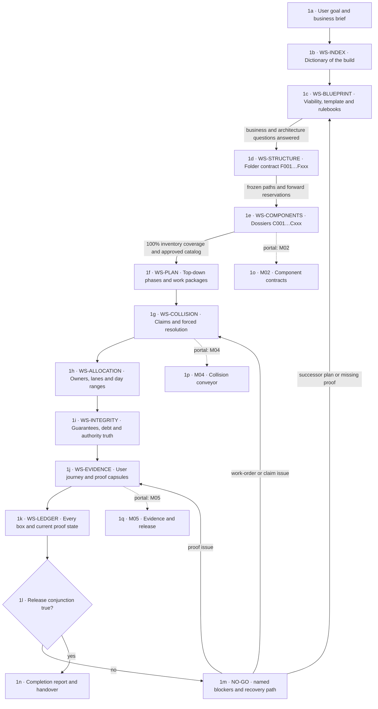

# M01 · Product and workspace path

[← M00 atlas](./00-map-atlas.md) · [Next: M02 component contracts →](./02-component-contracts.md)

The workspaces are separate because each answers a different decision. The Index is the only global dictionary. Detail belongs in its owning workspace and collapses when not needed.
