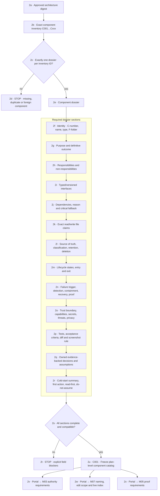
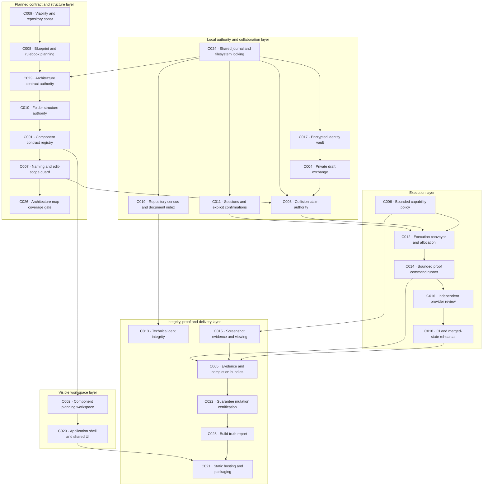

# M02 · Component contracts

[← M01 product path](./01-product-workspaces.md) · [Next: M03 trust and authority →](./03-trust-authority.md)

## Current executable inventory

Any component edit invalidates its catalog digest and requires architecture review, collision rescan, and proof-plan refresh. Chat history is never an input to verification.
