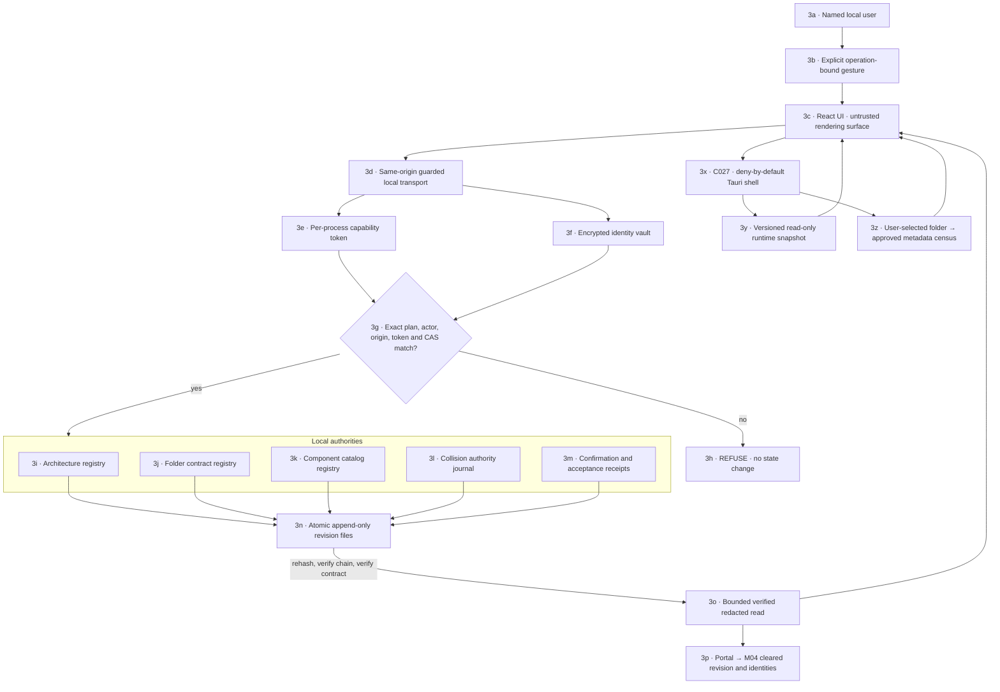
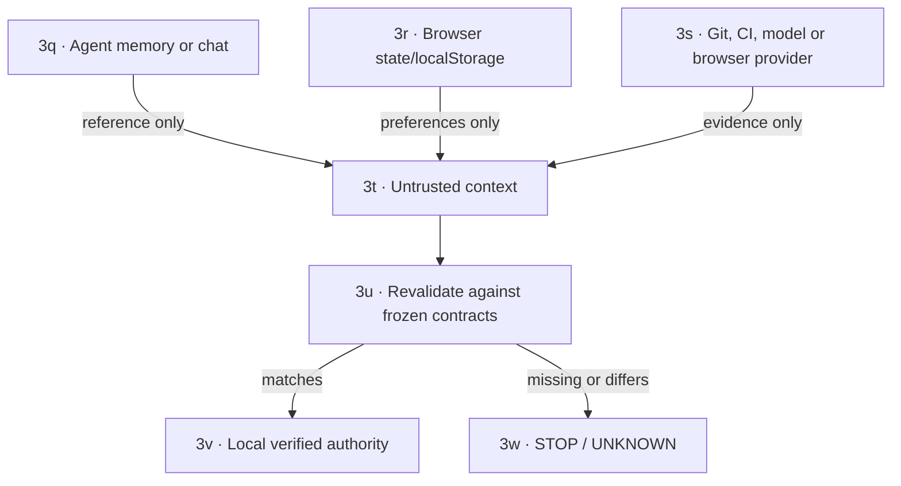

# M03 · Trust and local authority

[← M02 component contracts](./02-component-contracts.md) · [Next: M04 collision conveyor →](./04-collision-conveyor.md)

## Authority boundary

The native seam exposes a versioned inert runtime snapshot plus one user-triggered directory chooser, explicit root registration, and a bounded metadata-only census. Selecting a directory grants no read authority; registration and census are separate operations. No file mutation, process, secret, collision, approval, or release authority has moved behind Tauri yet.
