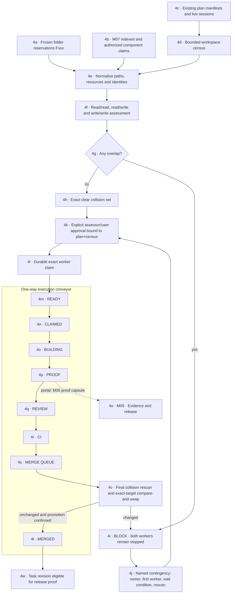

# M04 · Collision and execution conveyor

## Native inventory bridge verification · September 5

Operations client update: C034 now provides explicit inspection and copyable read-only local branch/working-copy details. The client rejects mismatched identities, malformed or authority-expanded responses; it drops expired/project-switched observations and locks retry on uncertain cleanup. Native headless fixture output is validated using this same client parser. Start/finish/failure diagnostics contain no paths or refs. This replaces the missing-display implementation noted below, but native webview and visual acceptance are still pending; merge/CI/production authority is unchanged.

C027 now implements the registered native inventory command and a dedicated Job-contained helper. The helper receives no request until containment is established; all Git descendants inherit the Job. Tests confirm termination of a live fixture helper and its child, rather than merely asserting cleanup flags. A fresh debug executable also verifies two working copies and branches, stale-registration rejection and preserved dirty/untracked work through headless input/output. Native tests: 26/26; ACL/analyzer/atlas: 28/28; all-target Clippy passes with warnings denied. No desktop automation or user repository mutation was used.

This is backend evidence only. Operations still needs exact identity-bound response validation, expiration, project-switch race handling and a truthful read-only display. Native webview IPC and packaged-release acceptance remain unverified. No clean-state, CI, production, merge, cleanup or deletion authority is inferred from inventory. Retained evidence and durable quarantine/reconciliation remain open.

## Registered Git inventory producer · September 5

C018 now produces read-only local branch/worktree observations through C031's `planner_git_inventory` MCP tool. The client supplies only a workspace ID and exact registration revision/root identity; the server owns registry paths and executable selection. Registration is checked before and after reading. A folder without its own `.git` marker reports `no-git-marker` without searching upward or inventing demo branches. Linked worktrees, detached HEAD, unborn repositories, and Git's locked/prunable annotations are represented; annotations never authorize deletion. Private lock/prune reasons are not returned.

Fixed commands are `rev-parse --show-toplevel`, `worktree list --porcelain -z`, and a bounded `for-each-ref` over local heads. Two matching complete reads are required; this is explicitly **not an atomic snapshot**, a filesystem lease, dirty-file inspection, completed CI, or production evidence. The selected root/marker and registration are checked again; changed output, lossy/unsupported names, partial output and exceeded limits fail closed. No fetch, push, merge, checkout, prune or project script is executed by this tool. Format definitions follow the [Git worktree manual](https://git-scm.com/docs/git-worktree#_porcelain_format) and [Git ref-format documentation](https://git-scm.com/docs/git-for-each-ref).

The reader limits output to 2 MiB aggregate, 500 local branches and 128 working copies. It uses an overall 20-second cooperative deadline and at most 10 seconds per process, plus the runner's 1.5-second cleanup grace. Filesystem I/O remains cooperatively bounded, not forcibly cancellable. Only one inventory runs per server process; cancellation keeps admission occupied until the in-flight command settles. An unconfirmed helper cleanup, including a thrown preflight failure, blocks further inventory for that process pending runtime reconciliation. This is not durable cross-process quarantine.

Real Git fixtures and MCP stdio tests verify local branches, detached/locked working copies, a repository with no commits, unchanged dirty/untracked files, stale registration refusal, parser limits, changed reads and admission/cancellation. The real registered clean-room folder was also queried via fresh stdio: its `.git` marker is absent and the tool correctly returns no branches, not sample ones. Native Operations display, shared native/MCP observation transport, pagination for larger inventories, protected durable quarantine and operator reconciliation remain required. The existing Codex host still needs to load its saved tool configuration; fresh-server transport success does not prove that host session or native UI integration.

## Managed Git executable boundary · September 5

C018's guarded Git runner now selects an absolute executable outside the checkout, never a PATH lookup. Its standard defaults are `C:\Program Files\Git\cmd\git.exe` on Windows and `/usr/bin/git` elsewhere. A nonstandard install needs an explicit authority-side `gitExecutable` override; project files, webview requests and MCP tool arguments must not supply it. Regular-file/canonical-path and identity-stamp checks repeat before each command. An unavailable or redirected executable fails closed; there is no fallback to a repository-local program.

The Windows containment helper is independently fixed to `C:\Windows\System32\WindowsPowerShell\v1.0\powershell.exe`, and conflicting `SystemRoot`/`WINDIR` environment spellings are normalized. Guarded Git rejects `GIT_EXEC_PATH` and loader/profiler controls (`LD_*`, `DYLD_*`, `COR_*`, `CORECLR_*`, `COMPLUS_*`, `DOTNET_STARTUP_HOOKS`) before launch. This closes search-path/helper-routing and inherited-loader substitutions; it is not executable publisher/signature attestation, an atomic file-to-process binding, or protection against an administrator replacing installed binaries. The generic bounded-process primitive still requires a trusted authority-side caller and is not exposed as an arbitrary MCP/UI command.

Focused runner/atlas verification passed 14/14 after helper hardening; final loader-refusal checks are recorded in the build ledger. Tests use disposable repositories and verify actual Git results with an unusable/hostile PATH, explicit executable refusal, conflicting Windows roots, hooks/filters, bounded output and descendant termination. Windows installs outside `C:\Windows` still need an authority-owned helper configuration flow. Live registered-repository inventory and its Operations/native transport remain open; no branch rows or production receipts were fabricated.

## Bounded retained-work inspection · September 5

C018 now exposes `inspectMergeRecoveryPage` for a trusted adapter to inspect an approved external transaction store and exact repository root. Each call examines at most 50 transaction IDs (25 by default), 256 records and 4 MiB of budgeted record bytes, with cooperative two-second deadline/cancellation checks. Directory enumeration is bounded before materializing a full listing. The legacy all-pending reader now shares record/byte/deadline bounds and refuses exhaustion rather than returning an incomplete success list. Blocking filesystem calls are not forcibly cancellable; these limits do not replace a killable native helper.

Pages return compact retained-state summaries, not full histories or worktree paths. Project attribution requires a valid journal and exact repository identity; corrupt records produce an unattributed uncertainty count, never a borrowed project label. Cursors bind the store, selected repository and transaction-ID listing; additions/removals invalidate them. `pageComplete` and `inventoryExhausted` are separate, and callers must retain uncertainty from earlier pages. Transaction content may change between pages: this is fresh per-page observation, not a consistent whole-store snapshot or a live Git census. Every result explicitly denies automatic deletion and promotion authority; a valid hash chain is not verified execution evidence.

Verification: the initial store plus real-Git-fixture integration run passed 22 checks with one Windows file-symlink privilege skip. After final budget hardening, store/atlas checks passed 19 with the same skip; two real Git fixture scenarios separately proved paged discovery of retained successful rehearsal work and pre-mutation intent after journal failure. Independent bounded review was completed. Native authority-owned store discovery/catalog, native/MCP transport, Operations display and safe operator reconciliation remain open. Oversized transaction directories are preserved and reported invalid without extracting their prior valid-prefix diagnostic context; no automatic repair or cleanup is provided.

[← M03 trust and authority](./03-trust-authority.md) · [Next: M05 evidence and release →](./05-evidence-release.md)

Git branches/worktrees are one optional transport for the belt. Private-folder mode uses the same claims, sessions, order, proof, and approval gates without inventing Git state.

## Product centre: loss-resistant change packages (T85)

The user-facing object is a named change package, not a branch-management chore. It owns intent, assigned people/agents, dependency and resource claims, the exact baseline, working copies, candidate identity, receipts and recovery state. The map summarizes packages; the Ledger owns their full obligations. Operations reports the underlying events and problems. Git supports compatibility and history; it does not define approval or completion by itself.

The required integration transaction is: preserve work → reserve claims → prepare exact candidate → rehearse and review → validate current proof → promote atomically → confirm receipts → retain recovery. No stage may silently turn an unknown result into success.

| Contract | Required behaviour | Evidence still required |
| --- | --- | --- |
| Preserve work | Inventory tracked, staged, untracked, binary and ignored-but-user-owned work; explicit bounded recovery protection before any destructive action. No automatic reset, force removal or deletion of rejected candidates. | Dirty-worktree and binary recovery tests; private recovery data handling; actual restore proof. |
| Record intent first | Durable transaction ID, exact roots, worker identity, claims, base/source refs and recovery pointers exist before side effects. | Crash injection before/after each side effect; restart reconciliation with observed Git state. |
| Prove the candidate | CI binds to the combined content, source/base IDs, command contract, dependency lock, tool environment and policy. Local branch checks are not merged-state proof. | Wrong-candidate, no-op check, changed dependency, stale receipt and moved-base rejection. |
| Coordinate safely | Parallelize independent work; serialize conflicting writes and final promotion. Reuse proof only where its exact bound inputs remain valid. | Concurrent worker/queue tests, stale lease tests and dependency-impact validation. |
| Promote exactly once | Compare-and-swap expected target against rehearsed target; persist confirmed result. A race requires a new candidate, never forced overwrite. | Target movement during promotion, duplicate/replayed request and lost-response reconciliation. |
| Recover visibly | Keep uncertain or failed operations inspectable. Resume only from verified checkpoints; rollback is a new recorded action, not history erasure. | Disk-full, interruption, cancellation, process crash and cleanup failure tests. |
| Separate delivery facts | Local acceptance, remote push, combined CI, release approval and production deployment each have their own receipt. | Live adapters and UI showing each actual transition, failure and recovery. |

Current implementation is partial: conveyor transition predicates, reservation materialization, isolated merge rehearsal, proof running and cleanup receipts exist. They do not yet implement a durable promotion/recovery transaction or prove loss resistance. T85 remains open. The custom-workflow option must not add another optimistic wrapper around Git commands.

### Frictionless means fewer decisions, not fewer safeguards

The everyday actions should be **Start package**, **Submit for integration**, **Review a real conflict**, and **Recover retained work**. The coordinator chooses an isolated workspace, waits for dependencies, queues the exact candidate, and explains only decisions that need a person. A failed check is not lost work; a disconnected provider is not a failed deployment; an interrupted process is an unknown outcome awaiting reconciliation.

Keep these concerns separate:

- **Package:** what is changing, why, owner, scope and dependencies. It survives changes of branch or provider.
- **Working copy:** the actual unfinished bytes, including staged, untracked and ignored user-owned files. Ownership does not expire merely because a heartbeat stops.
- **Candidate:** immutable combined content proposed against an exact baseline. A new baseline means new candidate identity.
- **Evidence:** the specific checks, inputs, environment and result tied to that candidate. Green from a different candidate cannot authorize promotion.
- **Transaction:** durable intent, observed side effects and reconciliation. A timeout never grants another worker permission to overwrite or delete the first worker's state.

Git-backed mode can preserve interoperability without exposing every Git command. Private-folder mode must earn equivalent preservation and recovery evidence; it is not automatically safer because Git is absent. Neither mode may use automatic force-push, reset or worktree pruning as a conflict-resolution strategy.

September 5 verification progress: rehearsal cleanup now retains changed/uncertain work and never force-removes it. Its baseline includes index objects and tracked, untracked and ignored file content; gate-created commits, same-status restaged changes and ignored output survive the focused preservation tests. Source/target movement invalidates green rehearsal proof. The allocator now waits for actual dependency completion even when a prerequisite sorts later, and rejects missing/duplicate/cyclic dependencies. These are bounded fixes, not complete crash-recovery or final merged-candidate authority.

Independent review subsequently identified a remaining race in even non-forced cleanup: another process can change tracked bytes after the preservation snapshot and before `merge --abort`. The required policy is therefore to **retain rehearsal candidates**, including successfully checked ones, with an explicit next disposition. Local verification may pass without granting promotion or deletion authority. A stale source/base must not be recorded as checks-finished; freshness and exact candidate/check-contract binding precede that journal milestone. Durable pending transactions make interruption discoverable, but restart reconciliation, retention storage budgets, safe eventual disposition and atomic target promotion remain required work.

The retained-only policy is now implemented with regression coverage. `assessCiTier3` no longer upgrades matching source/target SHAs plus two green observations to release truth: these do not identify the tested merge tree, environment or check contract. It deliberately remains grey (or red for an observed failure) until an authoritative exact-candidate adapter is implemented. Caller-supplied `promotionAuthority` flags cannot bypass this missing boundary. This removes a false-success path; it does not complete the integration queue.

Checkout-byte boundary: disabling external clean/smudge filters does not disable Git's built-in text/EOL conversion. A canonical blob and a checked-out working-copy file can legitimately have different bytes. Tests that assert LF bytes must declare that fixture policy explicitly; CRLF checkout needs separate coverage confirming the source working copy is preserved and the new worktree is clean under the repository's own policy. The guarded runner's public contract now states this distinction instead of promising raw-blob byte identity. Candidate and receipt designs must not confuse commit/tree identity with a byte-for-byte working-copy snapshot.
