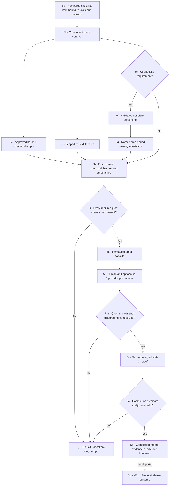

# M05 · Evidence and release proof

[← M04 collision conveyor](./04-collision-conveyor.md) · [Next: M06 private exchange and adapters →](./06-private-exchange-adapters.md)

The screenshot is proof of visible state, not proof of correctness by itself. The scoped diff is proof of changed code, not proof of visible outcome by itself. The box turns green only when the component’s exact conjunction is true.
