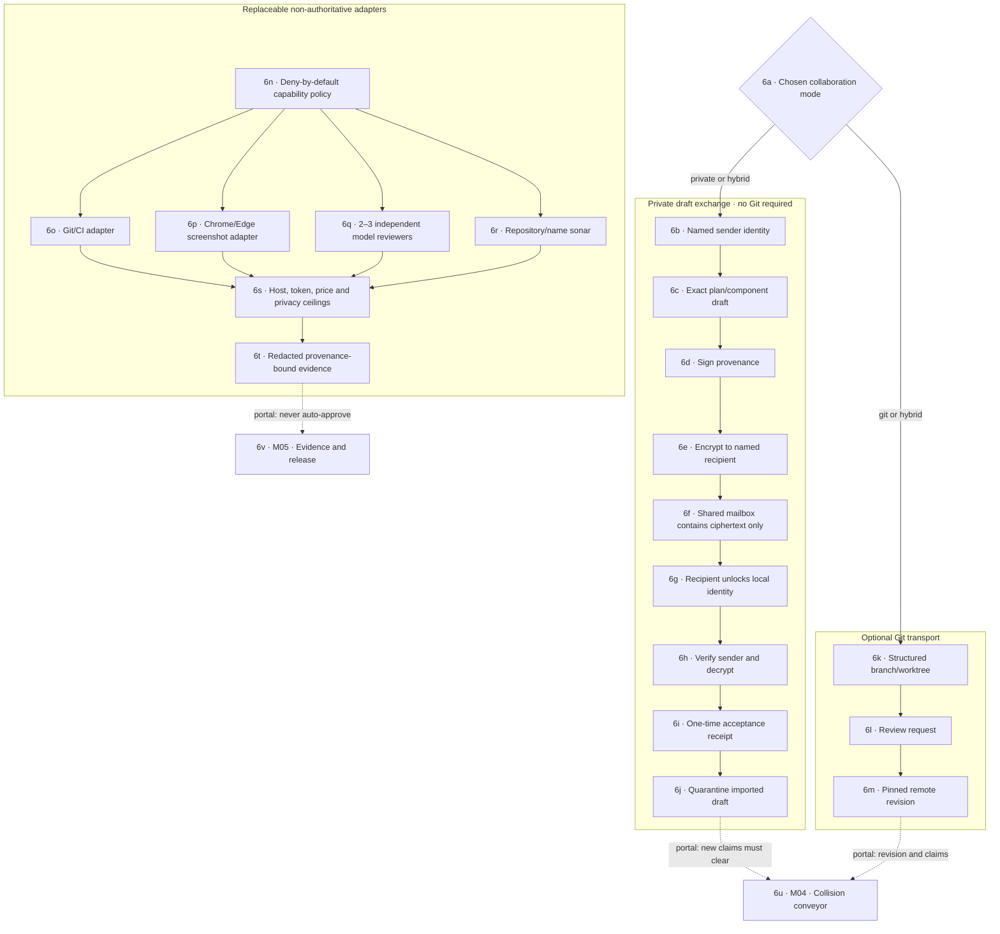

# M06 · Private exchange and adapters

## Current host MCP verification · September 5, 04:21–04:22 UTC

The loaded host now successfully exercises registered-app listing, mapping (333 scoped files, no skips), bounded literal search (three matches, capped) and exact registered Git inventory. This replaces the earlier host-reload blocker: no restart or Computer Use was needed in this verification. Git correctly returns `no-git-marker` for the clean-room folder; CI, production and clean-worktree state remain uninspected. The active tool catalog contains the four data-only tools and no Computer Use briefing. Native webview transport, security scanning and external delivery evidence remain separate unfinished work.

## Native registered Git adapter · September 5

Lifecycle correction: the client pending/quarantine gate is shared per webview runtime, not owned by the Operations panel. Disposal/recreation, project switches and late responses cannot erase uncertain cleanup. Eight focused controller tests cover this behavior. Native cross-restart quarantine and explicit reconciliation remain separate unfinished requirements.

C034 client update: Operations now invokes the exact native inventory command on explicit inspection, validates the response before display, expires it, isolates project switches and supplies copyable details. Start/result/failure events go to the existing project-scoped Operations ledger without private paths/refs. Browser-only projects remain disabled with a desktop requirement explanation. Actual headless native output passes this client validator; mocked DOM interaction is not native webview IPC proof. Release packaging, durable quarantine/reconciliation and final running-app acceptance remain open.

C027's separate `inspect_registered_git_inventory` command accepts a versioned request with project/generation/request identity plus the exact registered workspace revision and root identity. The authority resolves the root; neither arbitrary paths nor commands are accepted. Its dedicated stdio helper runs inside a Windows kill-on-close Job, assigned before sending the request, and returns an expiring metadata-only envelope. Unconfirmed cleanup keeps admission closed; this is process-local quarantine, not durable recovery. The existing metadata-only MCP helper retains its separate protocol.

Current proof: 26/26 native tests including real helper/descendant termination, 28/28 permission/analyzer/atlas tests, warning-free all-target Clippy, offline debug build and actual headless executable Git fixtures preserving dirty work and refusing stale registration. No Computer Use or desktop interaction was performed. Operations client validation/display, webview IPC, release packaging and cross-runtime reconciliation remain open; this evidence must not be displayed as successful CI or production deployment.

## Git metadata MCP seam · September 5

`planner_git_inventory` adds exactly registered, revision-bound local Git observations through the existing read-only bridge. It accepts no path, executable or arbitrary command. C018 owns the producer and tests; M04 records bounds, non-atomic consistency and unverified states. This does not grant worker, mutation, CI, cleanup or deployment authority. The saved Codex tool allow-list now includes the inventory tool while the Computer Use briefing remains excluded and availability remains zero. The narrow setting follows [official OpenAI MCP configuration](https://learn.chatgpt.com/docs/extend/mcp); no unrelated MCP settings were changed and no host/desktop process was restarted. Fresh MCP transport is verified; the existing host's loaded configuration and native Operations integration remain separate pending work.

[← M05 evidence and release](./05-evidence-release.md) · [Back to M00 atlas →](./00-map-atlas.md)

Adapters may collect evidence or carry drafts. They cannot expand capability, resolve collisions, approve a component catalog, or mark a checklist item complete.

## Operations/MCP integration audit · 2026-09-05 · T80/T82/T85 queued

### T85 catalog implementation staging

Read-only registered bridge staging: `inspectRegisteredMergeRecovery` in the MCP core now accepts the host-owned registry/catalog roots separately from an exact revision/root-identity/store-ID/catalog-head/cursor request. It resolves and rechecks workspace registration, discovers opaque store IDs, reads one bounded journal page, and refuses a changed catalog before returning. Canonical repository/store paths are omitted from its result. Missing association remains unknown; registered-only coverage and every page's incomplete/unattributed state remain explicit. It neither calls catalog registration nor grants mutation/promotion. This function is not yet registered as a stdio tool, native command or UI transport; host catalog configuration/adoption and mutation confinement remain separate requirements.

Unresolved independent-review blocker before wiring mutations: the shared path-based `withPlanLock` can create its lock after an ancestor was replaced between validation and acquisition. Static redirection checks are not a filesystem lease; they do not prove resistance to concurrent ancestor substitution. Do not expose catalog registration as a native/UI operation until lock/publication confinement is addressed with appropriate native authority and an injected substitution regression. Read-side refusal and current tests do not close that race. Publication byte ceilings are now checked before creating catalog records, matching both per-record and aggregate reader limits.

`mergeTransactionStore.mjs` now includes internal authority-side `inspectMergeRecoveryCatalog` and `registerMergeRecoveryStore`. A repository-hash directory retains immutable numbered discovery registrations for explicitly selected external stores, including custom rehearsal stores. Registration requires an expected head and named actor; duplicates, stale writes, overlapping roots, malformed/partial records and path redirection refuse. A missing association is `unconfigured` with unknown coverage. A valid association means only `registered-stores-only`, never proof that every historical store has been adopted. Reading does not create a catalog or edit a transaction journal.

These path-taking APIs are not browser or MCP endpoints and do not authenticate their caller. The future native authority must choose the catalog root, validate and recheck the registered repository, and authorize new-store registration or reviewed adoption. The rehearsal runner is not wired to this catalog yet; neither restart discovery through the native app nor Operations visibility is established by this staging. Register discovery before beginning new candidate work; preserve and explicitly review legacy/custom stores. Do not grant merge, deletion, reconciliation, CI or promotion authority from a catalog record.

This is a source-traced integration plan, not a connected runtime or an accepted end-to-end test. The standalone MCP transport and transaction-store foundations do not establish in-app connection health or recovery.

### Observed seams

- `src/main.jsx` mounts the shell without runtime capability receipts; `src/PerfectPlannerShell.jsx` defaults those receipts to an empty array. Its MCP switch changes a local preference, and connection actions check eligibility without executing a runtime action.
- `src/runtime/workspaceAdapter.js` selects folder, registration and census adapters only. There is no operations/MCP/recovery adapter. `RuntimeConnectionsPanel.jsx` consumes observations rather than producing a handshake.
- `vite.config.mjs` installs development-only collision, folder-contract and component-plan middleware. It has no runtime connection endpoint. These development bridges do not provide packaged desktop authority; the development server currently binds all interfaces, so its origin/token pattern is not sufficient by itself for a production local process service.
- `src-tauri/src/lib.rs` registers runtime snapshot, folder selection, workspace registration/census and collision authority commands only. Current native capabilities do not grant MCP launch or transaction inspection.
- `mcp/perfectPlannerMcpServer.mjs` serves real read-only tools over stdio. `scripts/verify-perfect-planner-mcp.mjs` exercises a real SDK client, but emits script results rather than trusted UI observations or operation events. Fixture-mode results cannot become live project receipts.
- `src/node/mergeTransactionStore.mjs` exposes bounded pending-transaction inspection with integrity/reconciliation state and `canAutomaticallyDelete: false`. There is no app authority catalog/transport connecting a selected project's registered repository to its external transaction store.

### Smallest bounded implementation sequence

1. **C031 + C027 / T82:** add a native-authorized runtime service using a fixed app-owned MCP executable/server/registry and bounded lifecycle. Check initialization, available tools and one metadata-only read against the selected native registration. Initialization alone proves protocol availability, not project access. Reuse service logic for development if needed; do not implement only a Vite endpoint and claim packaged support.
2. **C034 + C032 / T82:** bind producer observations to project ID and captured generation, workspace ID, root identity and registry revision. Validate trusted transport/session provenance before mapping the observation into the existing capability-receipt shape. An arbitrary object with the source label `mcp-handshake-receipt` is not authority. Browser-picked folders without a matching native registration remain explicitly unavailable for this bridge.
3. **C035 + C020 / T80:** ingest redacted request outcomes into Operations, including request ID, operation phase, original project/generation, duration and a bounded failure code. Capture scope at request start: the current shell diagnostic callback reads the currently selected project, which must not misattribute a delayed result after a project switch. A failed/revoked/expired check invalidates prior current health; browser-local event history is not a trusted receipt producer.
4. **C018 + C027 / T85:** expose read-only pending-work summaries through an authority-owned catalog from registered repository identity to allowed external transaction stores. Refuse browser-supplied arbitrary store paths. Filter and redact by the selected project; retain candidate work. Reconciliation, deletion and promotion require separate explicit authority and are not part of this inspection slice.
5. **C034 + C020 / T80/T82:** mount one runtime provider/adapter in the real entry point. Offer Check connection even when no usable receipt exists; distinguish preference, connection, project-read scope, call outcome and recovery state. Reconnect/revoke require real service lifecycle handling, not only a switch or toast.

### Gates before acceptance

- Exact native command permissions, fixed packaged service assets, bounded startup/request/output, cancellation and descendant cleanup; no arbitrary command/path/tool escalation.
- Native registry identity/revision validation and stale-generation cancellation; wrong-project observations rejected. A metadata-read-only grant does not silently authorize search content previews or computer use. A computer-use brief is not an executed desktop session.
- Never log unrestricted stderr, tool arguments, credentials or file/search contents. Keep trusted observations separate from editable/copied diagnostic text.
- Transaction-store discovery must remain bounded, preserve incomplete/corrupt journal warnings and never convert a timeout or missing response into successful cleanup.
- Real packaged/native round trip; project switch during a request; missing/crashed service; timeout/cancellation; malformed, stale and revoked observations; corrupted/incomplete transaction journals; reload recovery and browser-unavailable behavior. No completion from fixture receipts, component tests or a standalone smoke run alone.

The audit made no endpoint, configuration, native permission or user-repository changes. Implementation and acceptance remain queued in T80, T82 and T85; [M08](./08-ui-shell-workspaces.md) owns presentation and [M04](./04-collision-conveyor.md) owns preservation/reconciliation policy.

### Subsequent implementation: bundled metadata check

Client lifecycle follow-up, September 5: MCP admission now belongs to the webview runtime rather than a disposable controller. Clear result/project switch/disposal can stop accepting a response in that view, but cannot release native admission or cancel the independent deadline. A verified settled response may release pending admission; timeout, rejection, malformed output or explicit incomplete cleanup quarantine the runtime. Late success cannot remove quarantine. Recreated views inherit pending/quarantined state, and interrupted-request cleanup diagnostics stay bound to the original project. A second view acquiring admission also keeps the first view's Check control disabled. Six added lifecycle cases pass with the prior controller tests; DANS1 passes 66 focused checks and 193 DOM UI tests, plus an enhanced real-controller/mocked-native UI ownership check. This is session-only client enforcement, not a durable cross-restart quarantine or native GUI acceptance. The native backend remains responsible for containment and reconciliation. No continuous external MCP connection is implied.

The desktop now has an exact `check_bundled_mcp_connection` command and separate narrow capability. It probes a metadata-only MCP helper embedded in the same executable, using the pinned 2025-11-25 stdio lifecycle. No separately installed Node runtime, arbitrary executable, root path, tool argument or environment can be supplied by the webview. The app derives its registration store; the child verifies an existing workspace identity/revision and returns no paths or file content. Potentially blocking registered-root I/O runs in the killable helper. A one-at-a-time admission gate remains closed if cleanup cannot be confirmed.

`src/runtime/plannerMcpConnection.js` accepts only the exact native response contract, expires observations after at most 30 seconds, invalidates results on project/generation/registration changes, and records fixed diagnostic codes against the captured original scope. Project ID, generation and request ID are correlation fields; native authority verifies workspace ID, registry revision and root identity, not an independently signed project-to-workspace mapping. No observation grants tool execution, content reading, promotion or deployment.

Operations and the runtime panel expose **Check connection** and **Clear result**, distinct from external MCP-host preferences and capability receipts. The helper exits after a one-shot check; this is not a permanently connected server or continuous monitoring. Browser/demo/unregistered projects receive an explicit unavailable explanation. Clearing a result does not revoke the registered folder. This is the first native metadata-service integration, not replacement of the four-tool standalone MCP server or fulfillment of computer-use/recovery/CI integration. The protocol reference is [MCP lifecycle 2025-11-25](https://modelcontextprotocol.io/specification/2025-11-25/basic/lifecycle).

Source and focused tests are implemented. Packaged executable transport and native GUI IPC remain separate acceptance evidence; neither is inferred from mock-invoke UI tests. Pending-work discovery, retention storage management, provider credentials, independent external MCP sessions and merged-candidate promotion remain open.

#### External host revalidation and Computer Use opt-out

September 5 direct in-thread MCP inventory still returns registry-redirection refusal, despite the saved canonical registry directory passing a fresh-path check. A separately started real stdio client with that configured canonical root successfully lists registrations, maps the selected clean-room app (322 files, 31 directories, no tree truncation) and performs capped literal search. This isolates successful fresh transport from the still-failing existing host connection; do not label that existing connection repaired until its own call succeeds after restart.

The host's Perfect Planner `enabled_tools` now excludes `planner_prepare_computer_use` and its availability flag is zero, honoring the user's opt-out without changing unrelated servers. Server instructions prefer data tools/direct APIs and prohibit Computer Use fallback. `verify-perfect-planner-mcp.mjs --data-only` exercises inventory/map/search only, reports `exercisedTools`, and marks the briefing skipped. It does not control any UI. The upstream server still implements the optional briefing for other explicitly authorized clients; host allowlisting is distinct from removing that handler. Official [MCP setup guidance](https://learn.chatgpt.com/docs/extend/mcp?surface=cli) describes saving a server and selecting Restart; no supported programmatic restart was available here, and no process was killed or desktop controls used. The current host restart remains an explicit user-side step, not an excuse to weaken redirected-path protection.

## Enforced worker coordination and AFK supervision · T86–T88

User requirement, September 5: minimize parallel-worker startup context, enforce structured methods across connected MCP tools, prove communication with the orchestrator, and notify an absent user without relying on model initiative. This is an implementation contract, not a claim that these services are running.

### T86 · Ledger-derived dispatch and enforcement

Implemented context-generation boundary, September 5: `workerBrief.mjs` derives full assigned component obligations and dependency references from a verified catalog, without truncating required proof/recovery or granting execution. DANS1 reproduced a request-mutation defect: editing the task array during asynchronous verification could erase or replace the assignment. The generator now snapshots primitive task IDs before source serialization/verification, rejects accessors/sparse/duplicate IDs, ignores overridden array iteration/selection methods, and requires primitive digest strings in requests and binding expectations. Eleven focused checks pass on both Node 22 and 24, including the original source-mutation and new assignment-mutation cases. This is **not yet wired to planning completion, durable dispatch, authenticated acknowledgment or a tool broker**. A valid context digest does not prove that the plan is still current, that delivery happened, or that the worker has permission to act. The runtime sequence below remains required.

On explicit planning completion, freeze the ledger revision and validate coverage: every required task has an owner, dependencies, resource claims, acceptance checks, evidence requirements and a fallback. Generate a compact per-worker brief with project/package IDs, plan and policy revisions, exact input identities, assigned scope, next permitted action, blockers, required checks and references to on-demand detail. Persist a content digest and token-budget estimate; do not truncate mandatory obligations to meet a budget. Dispatch only after the worker acknowledges that exact brief revision. A changed plan invalidates affected briefs and grants; a stale worker cannot continue a mutation under its previous revision.

The broker, not the LLM, validates authenticated worker identity, current task/stage, tool allowlist, argument schema, approved resource scope, lease epoch, budget, preconditions and required human approval before executing any effect. Keep credentials in the broker, not in the brief. Treat tool descriptions, repository text and returned content as untrusted data. Validate effects and bind evidence before changing ledger state. Tools with broad arbitrary-shell or remote-execution power need equivalent sandbox and egress containment; schema validation alone does not contain them. Direct credentials, filesystem access or MCP connections outside this boundary cannot be claimed as enforced. The orchestrator itself does not bypass policy.

This can enforce known obligations and reduce unsupported actions, not prove a plan contains every real-world requirement or eliminate model hallucination. Independent review and adversarial tests remain required. Measure startup latency and actual token use; no unmeasured context-saving percentage.

### T87 · Durable communication and independent supervision

Use an append-only, project-scoped mailbox/outbox with stable message ID, sender, recipient, session/lease epoch, package and plan revision, sequence, correlation/causation IDs, payload digest and coordinator receive time. Track queued, delivered-to-worker-runtime, acknowledged-for-that-digest, acted-on-with-evidence, rejected and timed-out separately. Retry with bounded backoff and recipient deduplication; expect at-least-once delivery, not magical exactly-once external effects. Keep undelivered/unacknowledged messages visible. Acknowledgment proves receipt, not comprehension or correct action.

A non-LLM supervisor watches worker process liveness, broker-received heartbeat freshness, last meaningful progress/checkpoint and outstanding acknowledgment deadlines separately. Heartbeats come from worker runtimes, not model prose. Within a process lifetime use monotonic elapsed time; persist epochs and wall-clock observations for restart reconciliation. Sleep/resume, clock rollback and restarts require revalidation, not retroactive green. A missing heartbeat suspends new mutation grants but never discards work. Fence an old worker before reassignment; preserve its working copy and reconcile effects. Monitor the orchestrator as well as workers. A local process cannot notify during full machine or network failure: AFK coverage for that case requires an independently hosted missed-heartbeat monitor.

Current session-registry hardening rejects malformed/noncanonical times, backward release, duplicate/corrupt records, actor relabeling and null legacy-token authentication. Its existing 10-minute/24-hour freshness categories are not a production heartbeat SLA. Durable worker message transport, epoch fencing, runtime heartbeat producer and independent supervisor remain unimplemented.

#### Implemented storage boundary · September 5

`src/node/workerMessageStore.mjs` now provides an authority-constructed, project/plan/epoch-scoped journal for queued, delivered, acknowledged and evidence-verified acted states. Only authenticated senders/recipients participate; primitive digest references bind acknowledgments and an injected trusted verifier must attest the exact evidence tuple. No prompt, credential or unrestricted tool output is stored. C011 owns the service and its focused tests. This is a storage service, **not a connected worker transport, a verified production identity provider or an authoritative task-completion producer**. Test adapters are fixtures, not actual worker authentication or proof execution.

An independent checkpoint detects a missing journal, valid-prefix rollback and a complete append whose checkpoint was not published. Corrupt/uncertain records are preserved and new operations stop for reconciliation, not silently replayed as successful effects. Readers and writers share the publication lock, avoiding false corruption during an ordinary save. Append checks bind the previously observed file identity and bytes; digest schema rejects coercible arrays/wrappers. Adapter waits are bounded, signal cancellation, and refuse further calls to a stalled adapter until it settles; a valid result returned on abort is still refused. These are cooperative-runtime safeguards, not isolation against a synchronously blocking adapter, hostile filesystem writer or compromised authority process.

Focused verification covers reopen, duplicate concurrency, wrong recipient/digest/scope, revoked identity, stage skips, overdue work, backwards clocks, missing/malformed/tampered/hardlinked journals, uncheckpointed complete appends, in-flight replacement, publication reads, hung adapters and the cancellation-success race. The interrupted-append test simulates persisted crash-window state; it is not an injected physical disk/fsync failure or power-cut test. On supported non-Windows hosts directory synchronization is attempted, including duplicate retries. Node cannot portably synchronize Windows directories here, so power-loss durability is not claimed. Rolling back both journal and checkpoint requires an independently protected anchor to detect; no such anchor exists yet.

The service currently caps one scope at 2 MiB / 2,048 events and refuses further writes rather than dropping history. Archive/rotation, operator-led reconciliation, rejected/timed-out event recording, correlation/causation fields, native session binding, dispatch/retry transport and Operations presentation remain required.

Separate deadline implementation (September 5): new messages may bind `actionDeadlineAt` in addition to `deadlineAt` (the delivery/acknowledgment deadline). The action deadline must be an integer no earlier than the acknowledgment deadline. Replayed transitions, evidence verification and final append each enforce the relevant deadline; retrying the same message ID cannot extend either one. Inspection independently reports `acknowledgmentOverdue` and `actionOverdue` while retaining the journal state. A deadline passing is not an acknowledgment, completion, cancellation or takeover grant. Legacy messages without the new field retain their original shared deadline without rewriting journal bytes/hashes; older software refuses new-shaped records rather than treating them as legacy. Focused DANS1 verification passes 43/43 on Node 22 and 43/43 on Node 24, including the worker-brief/session suites. This is query-time journal behavior, not a running supervisor, dispatch transport or AFK notification.

### T88 · Notification delivery outside the model

Commit an alert to a durable outbox with the triggering ledger event. A background dispatcher sends minimal redacted fixed-template alerts for decisions needed, stalled/failed work, lost supervisor contact and verified completion. Track queued, sending, provider accepted, retry scheduled, delivery unknown and user acknowledged independently. On timeout after a send, retain uncertainty and deduplicate retries; on credential failure stop retry storms and show configuration needed. Bounded retry, rate limiting, quiet hours, escalation and explicit test-send/ack flows are required. Notification taps open the relevant authenticated decision; they do not approve a merge or execute tools.

ntfy is a candidate transport, not the supervisor or source of truth. It supports HTTP publishing and Android/iOS clients. Use authenticated private topics/ACLs and minimal payloads: do not send code, credentials, paths or raw logs. Default public-topic behavior is not appropriate for private project details. A provider HTTP success is not a phone-display or human-read receipt. Self-hosted iOS push and background delivery need platform-specific testing. Hosting choice, phone platform, recipient/channel, credentials and outbound-data consent remain user setup decisions; no notification account, topic, subscription or message has been created.

References checked September 5: [ntfy publishing](https://docs.ntfy.sh/publish/), [access control](https://docs.ntfy.sh/config/#access-control), [phone clients](https://docs.ntfy.sh/subscribe/phone/).

### Acceptance and UI

C004 runtime compatibility evidence (September 5): the PEM wire format is explicitly converted to cryptographic KeyObjects at the shared-secret calculation boundary, preserving Node 22 support rather than depending on Node 24's implicit conversion. No algorithm, signature check or replay authority is relaxed. DANS1 passes 57 handoff/mailbox/CI/atlas/truth/packaging checks on each of Node 22 and 24, plus the Node-22 web release build. Invalid private keys leave the replay slot unused; a subsequent valid opening still succeeds. These are fixture and build checks, not real-user custody, worker messaging transport, native UI or hosted CI proof.

Simple mode shows the assigned task, what is waiting, last verified progress and any decision needed. Advanced mode exposes brief revisions, grants, sequence/ack receipts, lease epochs, delivery attempts and redacted diagnostics. Both use the same authoritative state. Test missing brief acknowledgment, stale plan, wrong-project message, replay/duplicate/out-of-order delivery, worker and orchestrator crashes, network partition, sleep/resume, clock rollback, stuck-but-heartbeating workers, revoked tools, lost provider response, disabled phone notifications and failure of the monitoring host. No completed task, successful delivery or safe takeover may be inferred from silence.
