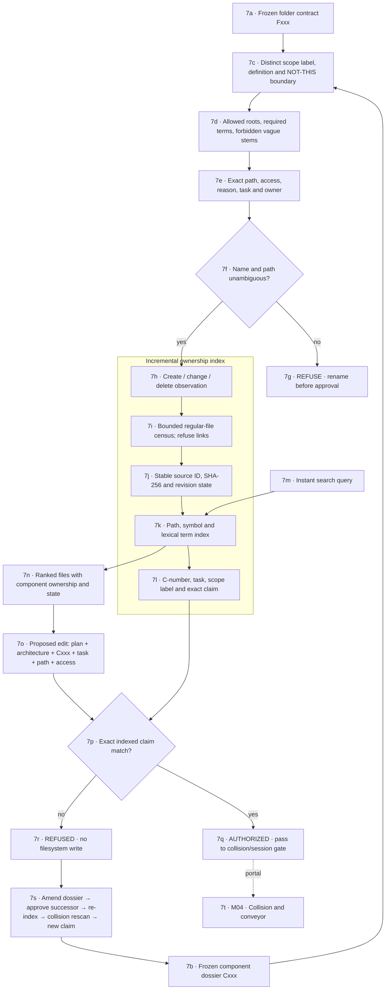
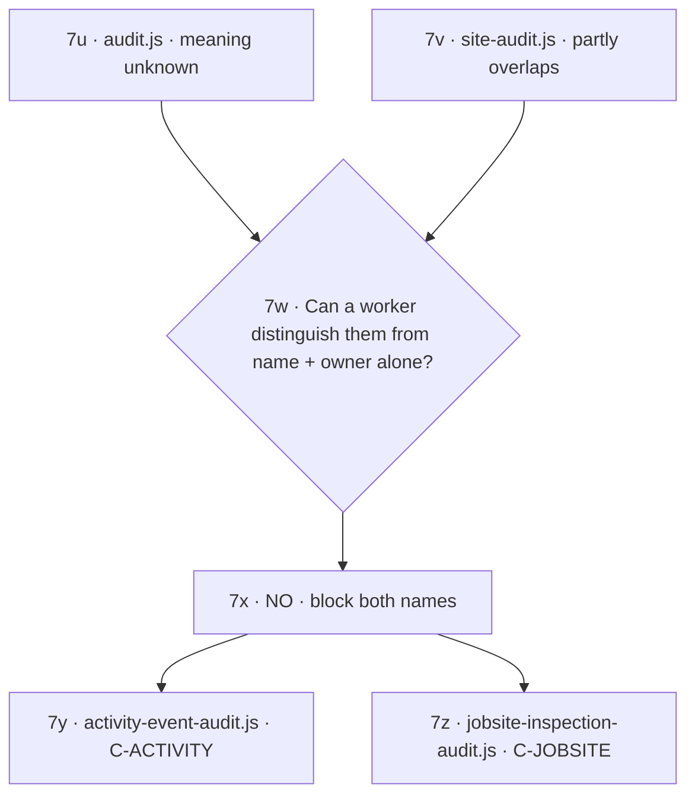

# M07 · Naming, edit scope and live index

[← M02 component contracts](./02-component-contracts.md) · [Next: M04 collision conveyor →](./04-collision-conveyor.md)

## Example that must not pass

A search result is not edit permission. It is a fast route to the exact component contract. The pre-write gate still requires the current architecture digest, component, task, path, access, collision clearance, and worker claim.
