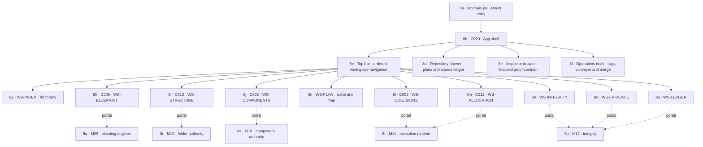

# M08 · UI shell and workspace surfaces

## Operations diagnostic recovery · September 5

### A06 transactional follow-through · C035 storage / C020 shell · required

Sequential stale-instance writes can now be refused before they overwrite newer diagnostic history. This is an interim preservation boundary, not simultaneous-write atomicity. The next implementation must use a separate device-local diagnostics IndexedDB store; do not reuse the planning-draft database or imply that transactional diagnostics are execution authority.

- Append and project-scoped clear read the latest validated envelope and write its successor inside one `readwrite` transaction. Resolve and notify only on transaction completion. Abort/quota failure preserves committed records and keeps sanitized pending events explicitly unsaved and exportable.
- Reuse the established task-draft connection lifecycle patterns: blocked upgrade, version change, open failure and transaction abort must not reset history. Cross-tab messages are refresh hints; receivers perform validated reads.
- Shell event capture must capture and sanitize project/generation before awaiting. Handle promise failures explicitly. Async initialization must not report empty/durable history before loading completes; refresh must reject stale project/generation and out-of-order results.
- Export must read a coherent global/project snapshot and clearly separate unsaved session events. A future clear confirmation binds to the revision reviewed by the user so it cannot silently delete unseen additions.
- Late native cleanup must not lose its pending append because a panel or shell view unmounted. Storage lifetime and view subscription lifetime are separate.
- Migration reads legacy localStorage without instantiating its rewriting constructor. Validate/redact a bounded snapshot in memory, then commit contents and an exact snapshot marker together in IndexedDB. Concurrent migrations must initialize only once. Leave original bytes untouched; changed old-tab history becomes explicit recovery, never automatic union/reimport that resurrects cleared events. No transaction spans localStorage and IndexedDB.
- Acceptance requires independent simultaneous writers, append/clear ordering and other-project preservation, one-time concurrent migration, no reimport after clear, aborted writes, blocked/unavailable/corrupt/future storage, stale async project results, missing/out-of-order notifications, and actual shell-remount late cleanup. These are requirements, not passing claims.

Candidate-31 regression placement triggered the existing exact-content synthetic-secret fixture guard. New stale-storage tests are now separate under C035; the original fixture and scanner policy remain unchanged. Current terminal evidence is recorded in the build ledger, not inferred from this plan. The separate working-source scan remains incomplete on DANS1 because its dependency tree is a junction; no clean-workspace or malware claim follows.

Unreadable local history is preserved, not cleared as a side effect of loading. Subsequent events remain in memory and Operations warns the user to export before closing; a zero-event session with failed history is not presented as healthy. Export remains available for the diagnostic-health report even without events. Local diagnostic history is explicitly not execution proof. Expanded event details and per-event copying now include the ledger-sanitized payload; unrestricted malformed stored bytes are never displayed or exported. Payload display wraps long text and has bounded scrolling. No new service, CI status, completion authority, or remote upload is inferred from these diagnostic controls.

Evidence: 31 focused storage/shell tests pass; the final two new UI cases were rerun after presentation adjustments, and 9 atlas/CSS contract tests pass. Web build/static packaging also passed with the existing bundle-size warning. Native interaction, exact before/after screenshots and visual acceptance remain pending: the user has disabled Computer Use, so no screenshot or desktop-control proof is claimed for this change. Recovery tooling to inspect or explicitly replace malformed history remains a separate unfinished workflow; this change only preserves the original and makes session-only operation clear.

[← M00 atlas](./00-map-atlas.md) · [Next: M09 planning engines →](./09-planning-engines.md)

The UI is never authority. Each workspace reads verified state, shows exact unknowns, and sends explicit requests to the owning local authority.

## Simple and Advanced presentation contract · T83

[Developer-experience research and acceptance criteria](../../research/developer-experience-2026-09-05.md) ground the September 5 beginner-friendly requirement. This is a planned contract, not an implemented mode switch.

Simple is the default: selected project, current change package, compact map, next action, blocking reason and visible recovery. Advanced adds precise diffs, branches/worktrees, dependency claims, queue/candidate identity, command and policy details, hooks and redacted diagnostics. The Ledger retains full requirements in both modes; Operations retains the same truthful events. Neither mode may independently compute authority or silently change settings/permissions.

Use one shared state machine, not necessarily identical screens. Preserve selection, unsaved work, filters and navigation position when changing modes. Plain language must remain precise: a saved local checkpoint, a commit, a remote push and a deployment are different events. Beginner-friendly guidance is not permission to hide code changes or enable destructive automation.

## Operations runtime handoff · T80/T82/T85 queued

The [M06 source-traced connection audit](./06-private-exchange-adapters.md#operationsmcp-integration-audit--2026-09-05--t80t82t85-queued) records the missing runtime producer and native transport. Normal app mounting currently supplies no live capability receipts; eligibility checks and the MCP preference are not a handshake. The transaction journal is not yet discoverable from Operations.

Preserve the anchored, resizable/collapsible bottom sheet and project-isolated copy tray. Add a real Check connection action that is available while disconnected, with clear checking/connected/unavailable/failed/revoked states derived from the owning service. Show original-project request failures and Recovery needed summaries without claiming that connection implies a passed check, permission to modify files, a remote push or a deployment. Both Simple and Advanced views consume the same verified observations; Advanced may expose request IDs, scoped grants, journal integrity and candidate identity.

Capture project/generation when each request starts; do not relabel a late result using the newly selected project. Project switching, expiry and revocation invalidate the current display without erasing prior-project diagnostics. A pending transaction is inspectable retained work, not an invitation to automatically clean it up. Native interaction, interrupted request/recovery checks and matching before/after UI proof remain required before these tasks can close.
