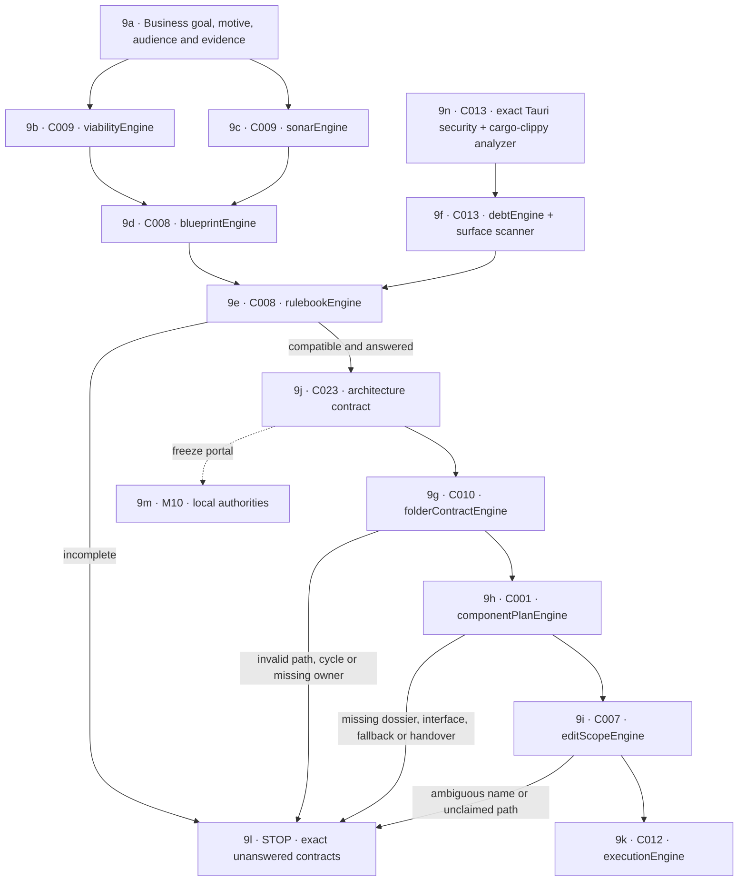

# M09 · Planning and architecture engines

[← M08 UI surfaces](./08-ui-shell-workspaces.md) · [Next: M10 local authorities →](./10-local-authorities.md)

Planning produces contracts and an ordered graph. It does not create code, folders, branches, or green proof as a side effect.
