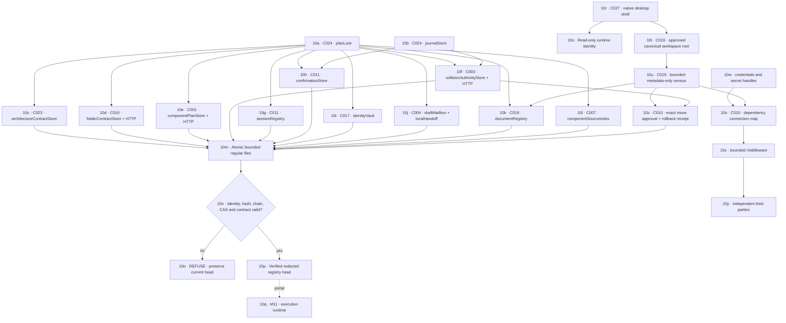

# M10 · Local authorities and durable stores

## T86-P01 · Project task drafts precede approval

C038 now exposes a local draft editor in the imported-project Ledger. Task IDs, full descriptions, proposed owners, dependencies, file scopes, acceptance and recovery are saved in project/root/census-bound IndexedDB revisions. Atomic head publication and expected-revision checks prevent cooperative browser windows from silently overwriting one another. Previous revisions remain readable and exportable. Read/write overlaps, missing obligations, cycles and archived dependencies stay explicit review findings.

This is a planning input, not an authority in the graph below. Browser state is neither a protected ledger nor a backup. The draft cannot mark work done, clear collisions, grant tools, dispatch workers, promote a branch or attest CI. A changed census keeps the existing draft readable while pausing edits. The explicit local review/rebind implementation is described below; native persistence remains required.

Remaining bridge: one compact Plan projection from the same tasks → reviewed native ledger revision → complete scoped worker brief → authenticated acknowledgment and tool broker → evidence-bound completion and preserve-first merge recovery. Do not translate a draft save or an empty findings list into any of these later states. T86-P02–P04 in BUILD-LEDGER track these missing links.

T86-P02 implementation: the Plan projection now reads the same saved draft through C038, with project/root/census-bound links back to Ledger records. Save notifications trigger a validated database read rather than carrying trusted task data. Revision/error labels distinguish loaded drafts from failed refreshes; dependency cycles are flagged and archived tasks are counted without implying completion. There is no force-driven layout, auto-fit shrink or second persistence copy. The reviewed native ledger, approval/dispatch and recovery bridge remain open. See BUILD-LEDGER for exact DANS1 test scope and the separate shell-navigation overlap exposed by screenshots.

T86-P03 draft review implementation: after a census change within the same project/root, the Ledger displays both inventory digests and every saved task, including archived records, with full obligations and claims. Explicit per-task review plus an unapproved-draft acknowledgment permits one appended revision bound to the new census. The same IndexedDB transaction validates the prior binding and expected revision, adds the new snapshot, and updates the head. Concurrent review, another root/project, invalid data, or storage failure must refuse without resetting history. Unsaved text stays in its original form binding and is not silently rebound. File existence/content verification, native plan freeze, complete history backup and worker authority are separate missing capabilities. This operation is not a receipt proving that the files were reviewed or are safe. BUILD-LEDGER records current acceptance evidence.

T86-P03 draft import implementation: the Ledger accepts an exported LOCAL_DRAFT file only for the exact project/root/current inventory. Review shows source/local revisions, full task obligations and the proposed ID mapping before an explicit acknowledgment. Recovery into an empty ledger preserves IDs; importing into existing history appends copies with remapped internal dependencies, leaving existing records untouched. Archived tasks remain archived. A single IndexedDB transaction checks the expected head revision, appends the new local snapshot and publishes its head; competing saves and storage failures preserve the old history. The UI blocks import while a form is unsaved. Raw JSON is limited to 8 MiB to accommodate pretty-printed exports, with the unchanged 1 MiB canonical-ledger and 500-task limits applied after parsing. Reimport creates another set of copies rather than silently merging or replacing. Imported source revision history is not restored, source revision numbers are not adopted as local authority, and no approval, worker grant or completion is imported. DANS1 candidate 24 verifies this bounded web workflow; BUILD-LEDGER links the exact tests and before/after evidence.

[← M09 planning engines](./09-planning-engines.md) · [Next: M11 execution runtime →](./11-execution-collaboration.md)

### T86-P04a · Stored-contract handoff, not execution permission

C001's `withStoredComponentPlans` now reads the full exact catalog revision and digest while holding its publication lock. C011's `createStoredWorkerBriefChannel` uses that stored contract, never renderer-supplied contract content, to preserve all assigned obligations in an immutable payload before queuing its digest in the existing worker-message journal. Read-only `authenticateSession` validates the enrolled session without publishing a heartbeat; redirected, multiply linked, oversized or changed authentication files are refused.

Trusted coordinator enrollment explicitly maps the project and plan revision to a **separate catalog revision**, contract digest, policy digest, epoch, worker/coordinator session IDs and task assignment. The current enrollment must match at each operation. Queue is coordinator-only; retrieval, runtime receipt and exact-digest acknowledgment are recipient-only. Inspection validates the complete saved enrollment and message tuple so a reused message ID cannot borrow another assignment's acknowledgment. A partial payload is retained and refused, not overwritten. Retrieval is not receipt; acknowledgment is not understanding, completion or execution authority. No `acted` or tool-grant method is exposed.

This service is an integration building block, not a native command or authenticated enrollment authority. The application must still supply durable trusted enrollment and policy state, connect imported-draft approval to the stored catalog, expose the reviewed native transport, enforce scoped tool access and supervise workers. The publication lock coordinates cooperating planner writers, not arbitrary external file edits; file synchronization is not a Windows power-loss guarantee. DANS1's separate-process proof uses a published test catalog and ephemeral test sessions—not a live provider or packaged desktop application. BUILD-LEDGER retains the full open requirement.

T86-P04b history-read hardening: full history and exact-head readback now share the bounded opened-file reader. It allocates only the observed size plus one growth-detection byte, reads at most 64 KiB per step, rejects links and changed identity/size/timestamps, and rechecks directory identities. At the end of history verification, earlier file identities and the revision inventory must still match. This detects the tested concurrent changes; it does not turn the observation into an exclusive filesystem lease. Publication applies the same 4,000,000-byte and 1,000-revision hard ceilings before writing a successor. Runtime policy may tighten those limits, never enlarge them. Refusals retain the previous records and leave partial or externally changed files available for explicit recovery; they do not silently repair, delete or reinterpret them. Exact DANS1 regression and separate-worker proof are recorded in BUILD-LEDGER.

Current native source registers nine commands: runtime identity; user-triggered folder chooser; read-only registration and census; bundled MCP check; registered Git inventory; and collision inspect, approve and commit. This source inventory is not a claim that the current packaged executable was built or tested. Choosing a folder grants no read authority; registration and census remain separate explicit steps. The census refuses links and root substitution and never returns source contents. The local C010 executor stores a named approval bound to exact workspace, census, source hash, destination and typed collision surfaces; its file-move/rollback behavior remains bounded fixture evidence. The native collision bridge is separately tracked as C037. No native task-ledger read/write/freeze command exists in this command list; the current draft UI therefore cannot acquire native plan or worker authority. Durable development stores and OS-backed identity migration must not be confused with the device-local draft database above.
