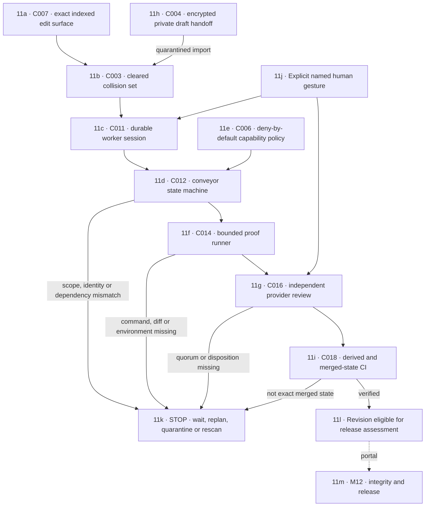

# M11 · Execution and collaboration runtime

[← M10 local authorities](./10-local-authorities.md) · [Next: M12 integrity and proof →](./12-integrity-proof-release.md)

Git branches and worktrees are optional conveyor transports. The identities, claims, order, proof, and human gates remain mandatory in private-folder mode.
