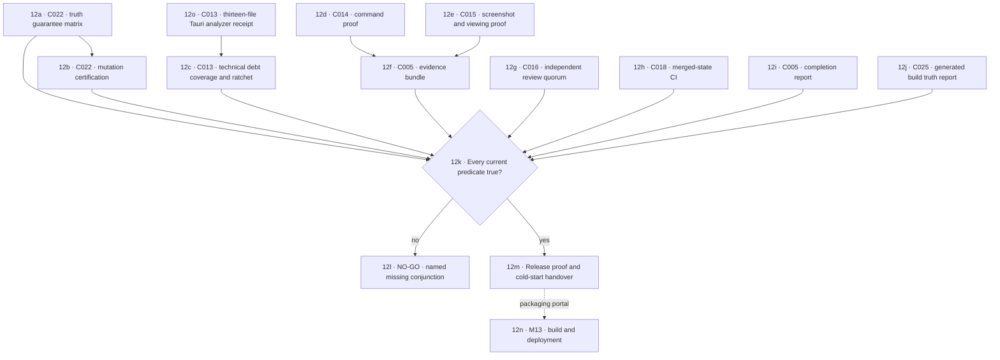

# M12 · Integrity, proof and release

[← M11 execution runtime](./11-execution-collaboration.md) · [Next: M13 build and deployment →](./13-build-tests-deployment.md)

Zero findings with missing coverage remains UNKNOWN. Native coverage is accepted only when the exact ACL, CSP, command surface, selected-file receipt, and direct no-shell cargo-clippy run all pass. A visual screenshot without scoped diff and viewing proof remains unproven.
