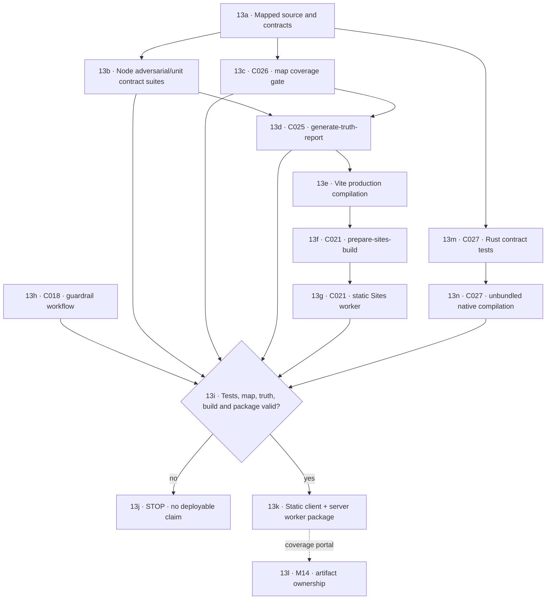

# M13 · Build, tests and deployment

September 5 optimized executable evidence: supported Tauri `--no-bundle` build succeeded with one compiler worker. Executable SHA-256 `82ba6d4ad63ae2ba53238f6f070b8cff94eec45d8cde139d668f60b6dbf33cb6`; Windows signature status `NotSigned`. The actual release binary passed the headless registered Git fixture verifier and bundled metadata MCP lifecycle/stale-binding verifier with confirmed cleanup. These prove only those helper paths, not native webview behavior, installer/update delivery, signing, malware protection or production deployment. Release readiness remains NO-GO. The core completion report's 16 items do not enumerate the whole real-life acceptance requirement; the master ledger and T80–T88 remain authoritative for that wider scope.

September 5 release-preflight correction: `verify:release` now starts with the real bounded workspace secret scan before building. Scanner unit tests do not substitute for scanning the actual candidate files. Full regression testing exposed stale content-hash approvals for two deliberate credential-redaction/transport fixtures; both complete files were reviewed and only their exact digests renewed. The path/rule/fingerprint constraints remain, and changed or relocated fixtures still fail. Pattern-scan success is not antivirus coverage, exact-candidate CI, production delivery or final release certification.

[← M12 integrity and proof](./12-integrity-proof-release.md) · [Next: M14 artifact coverage →](./14-artifact-coverage.md)

Static Sites packaging and native desktop compilation are separate outputs. The first native slice compiles and refuses undeclared authority; installer signing, updater, rollback, OS identity, and privileged adapters remain unproven release requirements.

## C041 · Local delivery checks

The versioned `.githooks/pre-commit` checks the exact Git index blobs. `.githooks/pre-push` receives Git's proposed ref updates and checks every tree in the outgoing commit history, then builds the complete package before running package-dependent tests. This covers a secret removed by a later outgoing commit. Both hooks stop on scanner failure or incomplete coverage.

The push hook delegates to `scripts/verify-local-push.mjs`. Project commands require an independently reviewed, external command approval bound to repository identity, package manifest, lockfiles, the guard and exact command sequence. Missing or changed approval blocks execution; no approval is generated automatically. Every non-deletion ref (including annotated tags after peeling) must resolve to the exact clean HEAD before and between checks. This is basic local branch proof, not merged-candidate CI, malware clearance or final release readiness. The operator-facing approval flow remains pending.

`scripts/verify-secrets.mjs` emits redacted findings, content/revision hashes, reviewed fixture match counts, coverage issues and a receipt hash. Known dummy values are exempt only when path, rule, matching-value hash and complete normalized file hash all match. A changed fixture requires review again. Source comments cannot suppress a scan. Git blobs are read directly without a shell; file, history, byte, entry and time bounds stop incomplete scans. Workspace scans explicitly disclose excluded generated directories. Credential pattern checks do not provide antivirus or archive-extraction proof.

`scripts/install-git-hooks.mjs` installs only in an existing checkout. The clean-room working folder has no Git metadata; installing hooks and observing real pushes there remain pending. Git hooks can be bypassed by Git users, so the server/CI gate must independently enforce release policy.

CI runs the MCP verifier with `--fixture`: a temporary registry and workspace exercise the stdio protocol on clean machines. Fixture output cannot attest to a live registered project or computer-use connection. Live MCP verification uses the installed registry and reports unavailable integrations explicitly.

Operations remains a summary of project evidence. Its bottom drawer supports vertical pointer and keyboard resizing, collapse, and a project-isolated editable copy tray. Live Git transport, bound scan-receipt ingestion, authenticated ClamShield verdicts, CI queue ingestion, and deployment receipts are still required before its pipeline can show a completed delivery.
