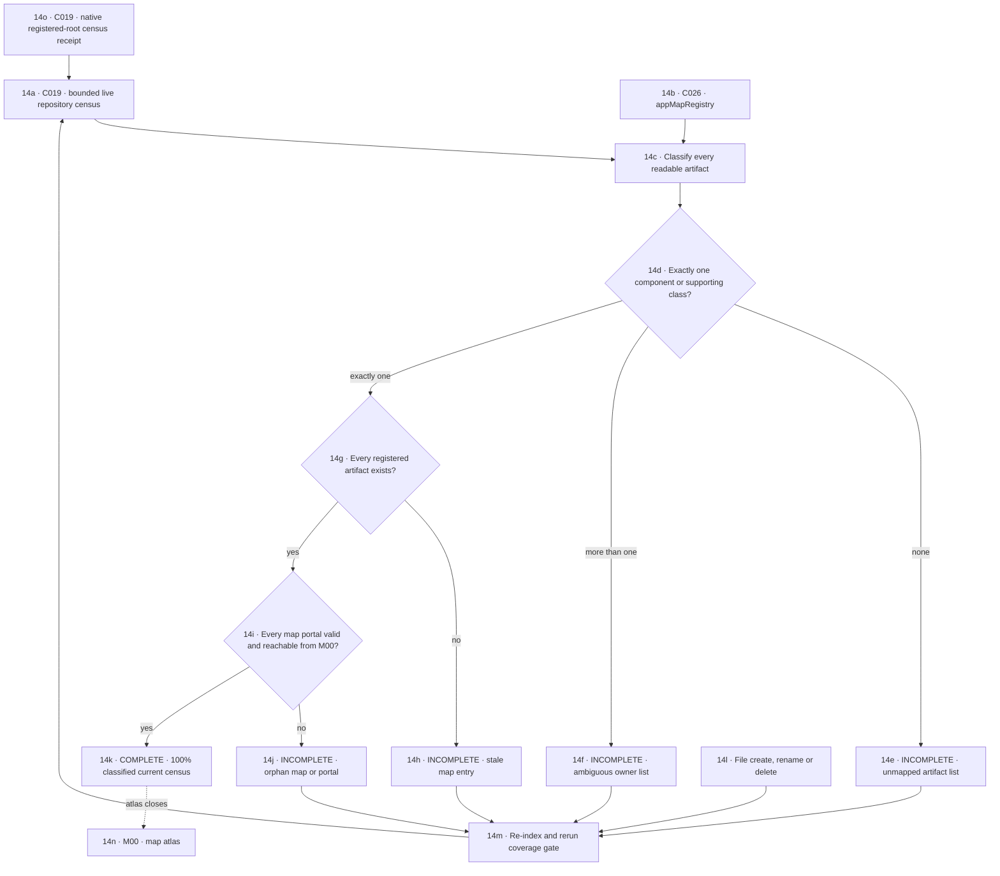

# M14 · Artifact ownership and coverage

[← M13 build and deployment](./13-build-tests-deployment.md) · [Back to M00 atlas →](./00-map-atlas.md)

“Complete map” means 100% of the current bounded registered-root census is classified, every component artifact has one owner, every registered artifact exists, and every map is reachable. The percentage is recomputed whenever the workspace changes. Intake is metadata-only; no organisation proposal may mutate files until a separate exact change set is reviewed and approved.
