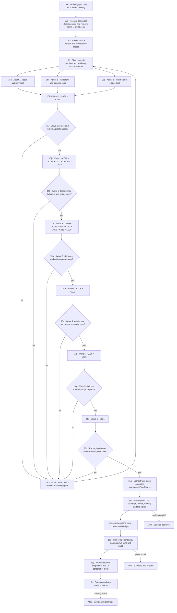

# M15 · Parallel agent dossier build

[← M00 atlas](./00-map-atlas.md) · [Contract gate: M02 →](./02-component-contracts.md) · [Collision gate: M04 →](./04-collision-conveyor.md)

Three workers inspect and draft in stable, collision-isolated ownership lanes. One orchestrator alone integrates the shared catalog. Dependency gates still control the merge order: parallel research does not make an unmet dependency complete.

## Stable ownership lanes

| Owner | Components, in dependency order | Output | Forbidden shared writes |
| --- | --- | --- | --- |
| Agent 1 · local authority | C024 → C011, C017, C023 → C010 | Source-grounded dossier fragments and evidence notes | `componentPlanSeed.js`, registry, maps, Index, Ledger |
| Agent 2 · repository/planning | C019 → C009, C013, C026 → C008, C022 → C025 | Source-grounded dossier fragments and evidence notes | `componentPlanSeed.js`, registry, maps, Index, Ledger |
| Agent 3 · runtime/release | C015 → C014 → C012, C016, C018 → C020 → C021 | Source-grounded dossier fragments and evidence notes | `componentPlanSeed.js`, registry, maps, Index, Ledger |
| Orchestrator | C020/C021 cross-check plus all integration | One reviewed catalog transaction and refreshed ledgers | Inventing absent agent evidence or silently changing an owned fragment |

## Dependency waves

| Wave | Parallel component set | Opens when |
| --- | --- | --- |
| 1 | C024, C015 | Census and canonical dependency graph are frozen |
| 2 | C011, C014, C017, C019, C023 | C024 is valid; C014 also relies on already-complete C006 |
| 3 | C009, C010, C012, C013, C016, C018, C026 | Their Wave 2 dependencies and existing C001–C007 dependencies are valid |
| 4 | C008, C022 | C009/C010/C013 and C013 respectively are valid |
| 5 | C020, C025 | C008/C010/C012 and C019/C022 respectively are valid |
| 6 | C021 | C020 is valid |

The minimum path is six dependency rounds. The tied critical paths are `C024 → C019 → C013 → C008 → C020 → C021` and `C024 → C023 → C010 → C008 → C020 → C021`.

## Collision and handoff rules

1. A C-number has exactly one authoring owner for the entire run.
2. Workers inspect real source, consumers and tests; repeated boilerplate is refused.
3. Each fragment names interfaces, dependencies, critical fallback, source of truth, lifecycle, failure recovery, security boundary, exact claims, tests and cold-start handover.
4. Workers return fragments through isolated messages or files. They do not edit `componentPlanSeed.js`, `appMapRegistry.js`, maps, Index or Ledger.
5. Registry artifact ownership is evidence for classification, not automatic write permission. Generic filenames such as `index.html`, `data.js` and `worker/index.js` require an explicit naming-policy decision.
6. The orchestrator integrates only after the owning lane supplies schema proof and a scoped fragment difference.
7. A dependency, census or boundary change invalidates affected downstream fragments and returns them to their original owner.
