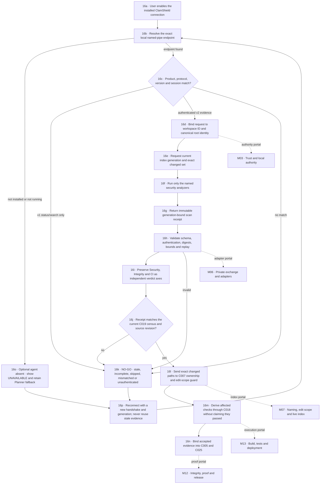

# M16 · ClamShield connection

## September 5 integration recheck

Read-only inspection of the separate ClamShield checkout at `C:/Users/danie/Documents/Codex/2026-08-30/be/outputs/ClamShield-Tauri` found `src-tauri/src/planner_protocol.rs`: bounded Planner protocol-version-1 definitions for capabilities, registered workspace census/delta, receipts and manifest pages. The module explicitly describes itself as isolated from the live service; a scoped search found no integration references elsewhere in `src-tauri/src`. No service was started, endpoint exercised, source copied or external files modified. Its `receiptSha256` is a content digest, not authenticated sender evidence. This separate proposed Planner protocol must not be confused with the existing index-service v1 or treated as the authenticated evidence path described below.

Planner correction: C028's current evaluator now always blocks its unauthenticated receipt path. External security, integrity and CI assertions remain `reportedSecurity`, `reportedIntegrity`, and `reportedCi`; effective verdicts are `UNAVAILABLE`, `UNKNOWN`, and `NOT_RUN`. A self-reported clean scan or self-computed digest cannot become `securityGate: PASS`. Contract/native-status/atlas tests pass 17/17, including rejection of external CI authority.

Still required: agreed authenticated transport and caller identity; explicit cross-product workspace-registration binding; current engine/definition/policy and content-generation proof; complete coverage and cache-validity evidence; replay/expiry enforcement; native approval and Operations integration; real clean/threat/incomplete/offline/restart fixtures. No antivirus protection is claimed from protocol definitions or tests alone.

[← M00 atlas](./00-map-atlas.md) · [Trust boundary: M03](./03-trust-authority.md) · [Adapter boundary: M06](./06-private-exchange-adapters.md) · [Index boundary: M07](./07-naming-edit-index.md) · [Proof boundary: M12](./12-integrity-proof-release.md) · [CI boundary: M13](./13-build-tests-deployment.md)

ClamShield remains its own installed security product. Perfect Planner never copies its implementation, opens its database, controls its updater, or treats its availability as permission to scan or mutate files. The optional connection is a versioned local adapter: Planner submits one bounded request for an explicitly registered workspace, and ClamShield returns evidence without becoming Planner's authority.

## Protocol truth

| Protocol | Permitted meaning | Forbidden meaning |
| --- | --- | --- |
| Existing v1 index-service IPC | Untrusted availability, status, baseline progress, catch-up state and filename search input | Malware-clean proof, Planner authority, CI success, source identity, authenticated evidence or permission to mutate |
| Proposed authenticated v2 evidence IPC | A bounded request and immutable receipt authenticated to one session, workspace root, policy, engine generation, definition generation and source generation | Direct database access, arbitrary filesystem access, process authority, release approval or a combined all-green verdict |

Planner must fail closed when it receives v1 data where v2 proof is required. A successful pipe connection proves only that a compatible process answered. It does not prove who produced a result, which bytes were assessed, whether coverage was complete, or whether any build/test command ran.

## Independent verdict axes

| Axis | Allowed states | Rule |
| --- | --- | --- |
| Security | `CLEAN`, `THREAT`, `INCOMPLETE`, `UNAVAILABLE` | `CLEAN` requires zero detections, zero errors, zero skipped required files and complete declared coverage. |
| Integrity | `UNCHANGED`, `CHANGED`, `UNKNOWN` | The result must bind the exact root, Planner census revision and ClamShield index generation. |
| CI | `PASS`, `FAIL`, `BLOCKED`, `NOT_RUN` | Only the isolated Planner CI/rehearsal authority may produce `PASS`; a clean security scan never implies it. |

The displayed result is a conjunction, not a blended score. Missing ClamShield keeps Security `UNAVAILABLE`; Planner may continue with its bounded internal census, but any plan that explicitly requires ClamShield proof remains blocked. A threat blocks affected work. Incomplete coverage remains incomplete even when every scanned file is clean.

## Minimum v2 receipt binding

An accepted receipt names the protocol and receipt versions, request ID, session identity, Planner workspace ID, canonical-root identity, Planner census revision/digest, ClamShield index generation, engine generation, malware-definition digest, policy digest, exact requested checks, start and completion times, files observed/hashed/scanned, cache hits, detections, skipped files, errors, coverage disposition, the three independent verdicts, and an authentication tag or signature over the canonical receipt. Unknown fields, missing fields, counter disagreement, replay, expiry, root drift, generation drift or authentication failure are refused.

## Parallel implementation lanes

| Lane | Exclusive ownership | Output | Must not do |
| --- | --- | --- | --- |
| ClamShield protocol worker | ClamShield IPC protocol, broker request handling and ClamShield-side contract tests | Authenticated v2 handshake, bounded scan request and immutable receipt | Edit Planner state, expose the ClamShield database, grant mutation, or label CI passed |
| Planner native-contract worker | Planner schema, receipt validator, native named-pipe adapter, exact permissions and focused tests | Deny-by-default local connection with offline, stale, replay and mismatch refusal | Copy ClamShield source, weaken the native ACL, infer authority from process name, or write shared UI/catalog files |
| Planner UI-evidence worker | Connection-map presentation, honest status normalization and evidence consumption tests | Optional D-numbered connection state and separate Security/Integrity/CI display | Mark availability live without verified health, collapse verdict axes, or approve release |
| Orchestrator | Shared component catalog, atlas portals, ledger, collision review and final integration | One reviewed C028/M16 integration after every lane proves its contract | Invent missing worker evidence, merge overlapping writes, or cross a failed dependency gate |

## Dependency waves

1. Freeze product separation, v2 schemas, threat model, canonical encoding and test fixtures.
2. Build ClamShield and Planner adapters in parallel against the frozen fixtures.
3. Prove offline, v1-only, invalid-authentication, replay, stale-generation, partial-coverage and counter-mismatch behavior before connecting UI or CI consumers.
4. Connect changed-path ownership, affected-check derivation and evidence binding without widening either product's authority.
5. Integrate C028 and atlas portals, run both products' focused/full suites, then capture scoped diff and human-viewed screenshot proof.

## Non-negotiable separation rule

The two applications may share a published protocol contract and deterministic fixtures; they do not share implementation files, mutable storage, signing keys or process authority. Uninstalling or stopping ClamShield must leave Perfect Planner usable and visibly degraded, never broken and never falsely green.
