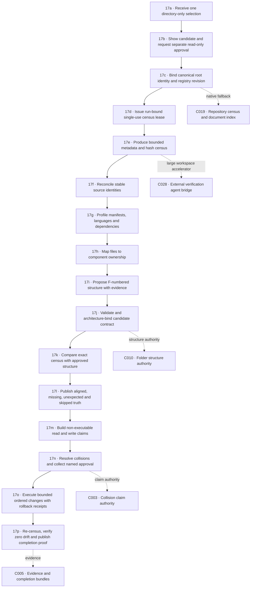

# M17 · Guarded app intake

[← M00 atlas](./00-map-atlas.md) · [Folder structure: M09](./09-planning-engines.md) · [Local authority: M10](./10-local-authorities.md) · [ClamShield connection: M16](./16-clamshield-connection.md)

An app enters Perfect Planner as evidence before it becomes a plan. Selection grants no read authority; analysis grants no mutation authority; automatic organisation means evidence-backed proposals first and exact approved execution later.

## Current delivery boundary

| Stage | Current state | Rule |
| --- | --- | --- |
| 17a–17c | Implemented | Native picker plus explicit immutable metadata-only registration. |
| 17d | Missing | Registration is durable, but the census still needs an expiring single-use run capability. |
| 17e | Implemented with limits | Native fallback is capped at 10,000 files, 2 MB per file and 50 MB total; larger projects require authenticated ClamShield paging. |
| 17f–17i | Partial/missing | Registries exist, but one generation-bound coordinator and semantic profiler are not yet connected. |
| 17j–17m | Implemented as guarded engines | Invalid architecture blocks mapping; proposals never authorize mutation. |
| 17n–17p | Partial | Exact single-file approval/execution/rollback primitives exist; batch transactions and final coordinated re-census remain. |

## Intake verdicts

- `SELECTED`: the folder path is visible but nothing has been read.
- `INVENTORY_READY`: bounded evidence exists; architecture mapping is still locked.
- `PARTIAL`: skipped, refused or overflowing artifacts prevent complete coverage.
- `REVIEW_READY`: the exact census is mapped to an approved structure and awaits human decisions.
- `BLOCKED`: identity, revision, capability, schema or evidence binding failed.

No intake verdict permits file movement. Mutation requires the later collision, approval, execution and rollback chain.
