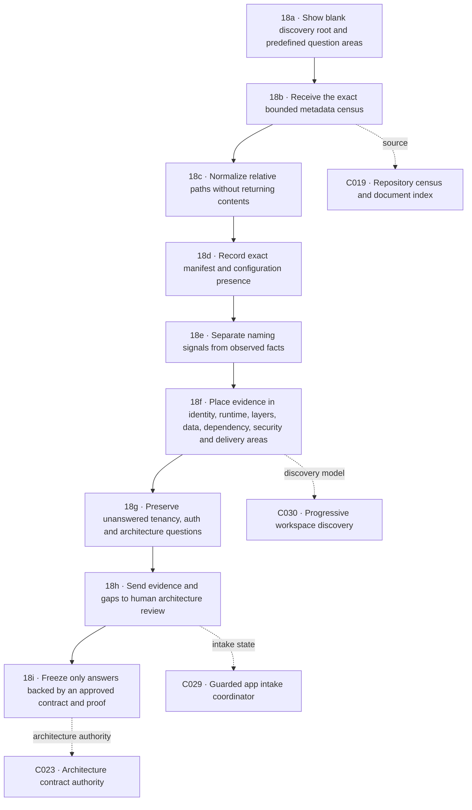

# M18 · Progressive app discovery

[← M00 atlas](./00-map-atlas.md) · [Guarded intake: M17](./17-guarded-app-intake.md) · [Planning engines: M09](./09-planning-engines.md)

The discovery canvas begins empty. Its stable sections are questions, not presumed architecture. Bounded metadata may add observed file facts or weaker review signals; it can never silently turn a filename into proven architecture, tenancy, permissions, or a live connection.

## Certainty contract

| State | Meaning | May turn green? |
| --- | --- | --- |
| Unanswered | No relevant evidence has been indexed | No |
| Review signal | A filename or folder convention suggests a possibility | No |
| Observed | The exact manifest, configuration, workflow, or test path exists in the bound census | Yes, for file presence only |
| Proven | An approved contract plus required execution evidence confirms behavior | Only after later review; discovery cannot issue it |

The first discovery release reads no source contents. Package membership, runtime behavior, identity enforcement, tenant isolation, secret values, connection health, and deployment success therefore remain outside its authority.
