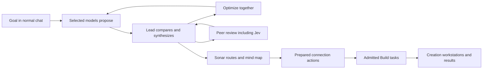

# Build: chat, create, compare

User design direction, 27 September 2026. This is an implementation contract, not a claim that model services are connected.

## One workspace

Build opens with one main conversation and a bottom composer. Its compact controls are Chat / Orchestrate / Peer review, the active model, attachments and send/stop. A goal can be dropped or typed into the composer. Ordinary conversation remains the default.

The layout control selects Single, Split or Model grid. Split retains the conversation on the left and a selected preview, file, diff, Sonar map or output on the right. Model grid opens the chosen participant conversations with one shared composer. Pane changes preserve the draft, selected recipients, scroll context and history. Narrow screens use selectable panes instead of compressed unreadable columns. Dividers support keyboard resizing.

Planner keeps its own established visual language. The screenshots specify interaction and layout, not permission to copy another app's source, branding or assets.

## Orchestrate

1. Enter the goal and constraints. Choose a lead, contributors, round limit and cost ceiling from actually available providers.
2. Send the same revision-bound brief to selected contributors. Show attributable outputs as they arrive; retain errors and outstanding responses.
3. The lead compares the available proposals. Its synthesis references their IDs, identifies useful alternatives and disagreements, and explains which changes it made. A missing proposal is explicitly excluded, never treated as agreement.
4. “Optimize together” sends that synthesis plus the selected comparison context to contributors. Each returns proposed improvements against the exact synthesis revision. Previous outputs remain visible.
5. The lead produces the next version. Show what changed, unresolved disagreements, usage and remaining budget. Stop at the chosen round/budget limit or at any user cancellation; repeated rounds are not automatic permission to spend indefinitely.
6. Send the selected version to Sonar for ranked routes and connector preparation, to Peer review, or to the guarded Build task flow. Planning output alone does not authorize code changes.

## Peer review

Peer review can be launched on any selected response, plan, diff or result. It binds reviewers to the exact content revision and asks for findings, evidence, severity and suggested changes. Keep approvals, objections and unavailable reviewers separate. Changing the reviewed content marks earlier reviews as belonging to the earlier version.

Jev is a requested participant label. Its model/provider, prompt contract and adapter must be identified from configuration before dispatch; do not silently assign it to another provider. Multiple views of the same model are not independent reviewers merely because they have different labels.

## Observable work

The Creation panel links each workstation to the participant, task, attempt and latest observed event. Stream text, tool activity, bounded logs and previews only when available through the scoped adapter. Working, waiting, blocked, disconnected and finished have distinct labels. A model response is a proposal; a build receipt records execution; verification is its own outcome.

## Contracts and integration

Reuse the existing project authority, provider gateway and budget mechanisms where present; inspect executable code rather than treating historical component plans as implementation evidence. Dispatch must retain project ID, plan revision, orchestration ID, round ID, participant/provider/model identity, request ID, input artifact digest, deadline and reserved budget. Results reference their exact request and immutable output artifact. Lead synthesis references all included result IDs and explicitly records missing participants.

Changing layout never dispatches, retries or grants access. Cancel prevents new sends and reports already in-flight requests separately. Restart restores the journal and unresolved requests; it must not resend silently. Providers receive only the explicitly shared context for the selected project.

## First implementation slice

Inspect the real imported-project Build surface (the demo conveyor is a separate path). Introduce the conversational layout there with the actual project context. Connect an existing authenticated provider transport before enabling Send; keep Sonar planning usable without a provider. Wire real dispatch, receipts and cancellation before representing a pane as live. Add split preview and attributed participant rounds, then lead synthesis and Jev integration. Validate fixtures separately from actual connected-provider acceptance on DANS1.

## Acceptance

Normal chat and split/grid layouts preserve drafts, history and project isolation. Targeted dispatch sends to precisely the selected recipients. Partial failure, stale outputs, duplicate results, lead failure, cancellation, restart and budget exhaustion retain truthful history. Sonar routes and Creation activity link to the same tasks. DANS1 Fast CDP verifies the visible interaction and keyboard access; real provider receipts establish live orchestration separately from UI fixtures.
