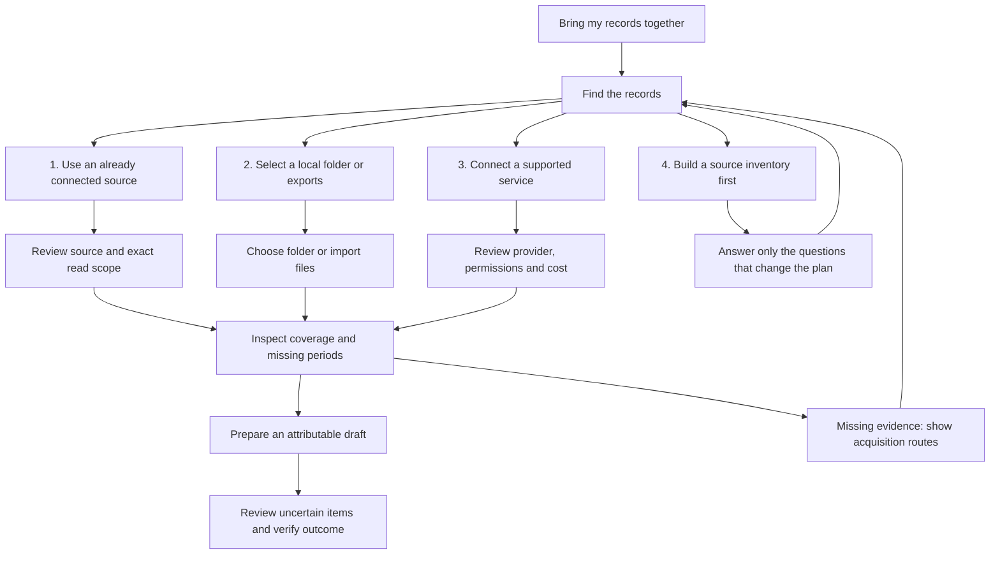

# Goal-first route planning

User direction, 27 September 2026. Design and acceptance contract; not a claim of implemented UI, completed Sonar research or connected accounts.

## Primary experience

The top of the screen keeps the desired outcome and current task visible. For the supplied example: “Bring my financial records together” / “Find the records.” Below it, show a route mind map and an ordered shortlist. Detailed evidence and unknowns sit behind their corresponding nodes instead of becoming a wall of text.

Each route shows the outcome it enables, why it is placed here, what already exists, what the app can do now, the next user action, and a fallback. Ranking first considers usable existing access and useful partial outcomes, then user effort, coverage, cost and privacy preferences. Unknown availability is explicit; hypothetical providers receive no working connection badge.

## Example path map

This ordering is illustrative, not a researched recommendation or a claim that a financial connector is available. Actual ordering must update from capability checks and the user's priorities. The screenshot is product feedback, not authorization to read financial accounts.

## Planning before access

Complete the task breakdown, dependencies, alternative routes, available capability discovery and likely permission needs before presenting connection actions. Unknown private data does not prevent this work. Collect questions together only when their answers materially change the plan. Partial results remain usable and clearly scoped.

The user clarified that Sonar means Planner's own planning feature, not Perplexity. Its repository/naming evaluator now also has a pure task-route planner: it orders supplied source capabilities, produces map edges and fallback paths, and prepares scoped action descriptors. It does not discover services, perform external research or authorize connections. Source discovery, visual integration and actual adapter handoff remain to implement. Any research evidence must carry dated sources; generated assumptions must remain explicit.

## Actionable connector shelf

At the end of planning, show only the actions needed by the selected path, in dependency order. Each action carries project ID, plan revision, task ID, provider/adapter ID, requested scope, purpose and supported authorization entry point. Already usable access offers “Review source”; available unconnected access offers “Connect”; local input offers “Choose folder” or “Import files.” Unsupported providers offer a specific alternate path instead of a dead button.

Clicking a connector starts its actual supported authorization flow. It does not grant unrelated access, mark the task done or start side effects beyond the reviewed scope. Record refusal, expiration, failure and cancellation and return to the same map with a fallback selected or offered. A successful authorization is followed by a capability/read check before displaying “Ready.”

## Creation handoff

Selecting an executable path creates revision-bound tasks in the authoritative ledger. Creation workstations show worker assignment, current observed action, latest event time, attributable previews/output and blockers. Selecting a workstation opens that task's map node and retained history. Work can proceed on independent branches while a connection waits. Motion follows fresh observed activity; absence of events is not evidence of progress.

## Required implementation and proof

- A route contract binds goal, task, alternatives, sources, dependencies, ranking rationale and connector capability states to project and revision.
- The mind map and accessible ordered list share selection and authoritative state. Keyboard users can reach the same actions without manipulating a canvas.
- Every missing-input node offers a route to resolve it; genuinely unavailable paths explain the exact prerequisite and retain an alternative.
- Controlled tests cover absent data, unavailable and revoked providers, stale research, stale plan revisions, failed authorization, project switching and restart.
- DANS1 Fast CDP verifies actual map/list navigation and adapter handoff. Fixtures and mocked authorization are labelled separately from real connector acceptance.
- Current status: design recorded under L44; production integration and acceptance remain open.
